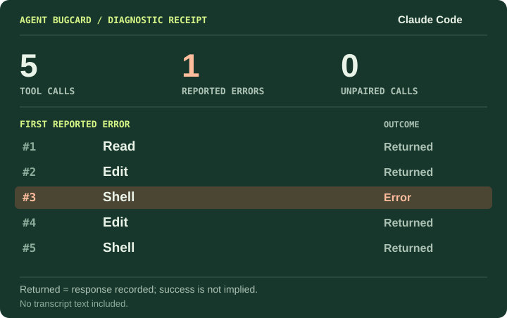

# Agent Bugcard

[简体中文说明](README.zh-CN.md) · [繁體中文說明](README.zh-Hant.md) · [直接试用中文版](https://vighzhen.github.io/agent-bugcard/?lang=zh-Hans)

Turn a **Claude Code or Codex CLI failure into a GitHub issue attachment**. The tool reads one session file on your machine and shows which tool call failed. You choose whether to include nearby calls, tool categories and shell exit codes. Your prompts, commands, paths and raw output stay private.

[**Try the demo with a sample session**](https://vighzhen.github.io/agent-bugcard/) · [Download the offline HTML](https://github.com/vighzhen/agent-bugcard/releases/latest/download/agent-bugcard.html) · [Offline ZIP](https://vighzhen.github.io/agent-bugcard/agent-bugcard-offline.zip)



**What can a maintainer do with this?** In the sample above, the reporter chose to share exit 127. A maintainer can ask whether the executable is on the agent's PATH. Switch to the Codex example for exit 126 and the next question becomes whether the command can be executed. Programs can also return these codes themselves. The card records a starting point for triage. [Bash exit status reference](https://www.gnu.org/software/bash/manual/html_node/Exit-Status.html)

## Attach a receipt to an issue

1. Open the demo or double-click the downloaded HTML to work offline. Both bundled examples are synthetic.
2. Choose **Open local JSONL** and select the session where the problem happened. Exit codes start hidden for every local file. If several calls reported errors, use **Focus on** to choose the call you want to report.
3. Review the sharing options and select **Copy for GitHub issue**. Paste the Markdown alongside a sentence describing what you expected. For team chats, copy plain text or save a PNG. The card language can differ from your interface. SVG and Markdown files are available under **Other files**.

**Finding your session.** Claude Code usually stores JSONL under `~/.claude/projects/`. Codex CLI uses `~/.codex/sessions/YYYY/MM/DD/`. On Windows, start in your user folder. If you configured `CLAUDE_CONFIG_DIR` or `CODEX_HOME`, use that base folder. Open one saved session up to 20 MiB. [Claude configuration](https://code.claude.com/docs/en/settings) · [Codex environment variables](https://developers.openai.com/codex/environment-variables)

## CLI

Node.js 18+ is sufficient. From a clone of this repository:

```sh
node bin/agent-bugcard.cjs examples/claude.synthetic.jsonl --exit-codes
node bin/agent-bugcard.cjs examples/claude.synthetic.jsonl --lang zh-Hans --format text
node bin/agent-bugcard.cjs examples/claude.synthetic.jsonl --call 3 --exit-codes --format svg > receipt.svg
node bin/agent-bugcard.cjs path/to/session.jsonl --summary-only > receipt.md
```

`--call N` selects the numbered error call shown in the card. `--hide-categories` and `--summary-only` also suppress numeric exit codes and their troubleshooting hints.

## What the card discloses

| Included | Controlled by the reporter | Kept out |
| --- | --- | --- |
| Agent format, recognized call/error/unpaired counts, parsing warnings | Up to five call positions around the selected failure, broad tool categories, numeric shell failure codes (1–255), fixed hints for 126 and 127 | Prompts, responses, commands, output text, source code, paths, custom tool names, IDs, timestamps and environment values |

Unknown tool names collapse to **Other**. A distinctive call pattern can still reveal a workflow. The app reads only the chosen file, has no backend or analytics, and blocks network connections while processing. The receipt contains a link to this repository. [Self-contained app source](docs/index.html)

## Reading a result

- **Error** means the trace reported a tool error. For Claude Code, Bugcard pairs tool calls with results by ID. For Bash errors it recognizes the supported leading exit-code header. For Codex it reads structured command-completion events, legacy shell result metadata and the supported unified-exec header. Exit codes and hints appear only when enabled. [Claude content-block types](https://github.com/anthropics/claude-agent-sdk-python/blob/main/src/claude_agent_sdk/types.py) · [Codex command item](https://github.com/openai/codex/blob/main/codex-rs/protocol/src/items.rs)
- **Returned** means the tool supplied a response. The operation or overall task may still have failed.
- **Unpaired** means no matching completion was observed. Unsupported events and model-only mistakes may have no visible error. Malformed lines and unmatched results are counted when a card can be generated.

Did a real case need another field? Tell us which follow-up question the card left unanswered. For parser issues, please use an invented minimal fixture. [Open an issue](https://github.com/vighzhen/agent-bugcard/issues)

```sh
npm test
npm run build
python3 scripts/pack-offline.py docs/agent-bugcard-offline.zip
```

MIT licensed. Independent project.
