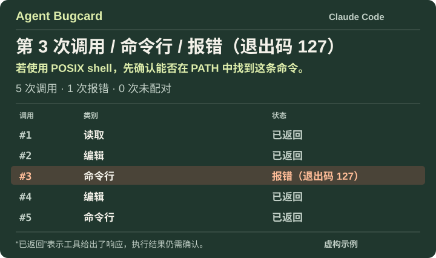

# Agent Bugcard · 工具报错诊断卡

[**打开简体中文演示**](https://vighzhen.github.io/agent-bugcard/?lang=zh-Hans) · [备用单文件下载](https://cdn.jsdelivr.net/gh/vighzhen/agent-bugcard@v0.3.0/docs/index.html) · [离线压缩包](https://github.com/vighzhen/agent-bugcard/releases/latest/download/agent-bugcard-offline.zip) · [繁體中文](README.zh-Hant.md) · [English](README.md)

Claude Code 或 Codex CLI 报错时，把失败的那一步发给同事。工具在你的电脑上读取会话，把调用顺序、工具类别和你选中的退出码整理成一张卡。命令、文件路径和原始对话留在本机。



先试内置示例。Claude 示例的退出码是 **127**，可以先查命令名和 PATH。切到 Codex 示例，退出码是 **126**，排查方向变成了文件类型和执行权限。这些是 POSIX shell 下的排查建议，程序也可以自行返回同一个数字。

## 发到群聊、工单或 Issue

1. 打开演示，点 **Claude 示例** 或 **Codex 示例**。处理自己的问题时，点 **打开本地日志** 选择一份 JSONL 文件。真实文件的退出码默认隐藏。
2. 选择要分享的调用、类别和退出码。界面和卡片的语言可以分别设置，例如用中文操作，给英文项目生成英文报告。
3. 发微信群或飞书时，点 **复制群聊文本** 或 **保存图片 PNG**。贴 GitHub Issue 或支持 Markdown 的工单时，点 **复制 Markdown**。在正文补一句你期待发生什么，就可以交给维护者。

浏览器不允许直接复制时，页面会选中原文，电脑可按 Ctrl+C 或 ⌘C，手机可长按复制。通过聊天软件收到压缩包时，先解压，再用电脑浏览器打开 `agent-bugcard.html`。演示、解析和导出都能断网使用。

## 从备用地址获取离线文件

若演示或 Releases 打不开，可以从备用 CDN 获取同一份 HTML。浏览器可能显示源代码；用“另存为”保存为 `agent-bugcard.html`（文件类型选“所有文件”），再双击打开。Windows 也可以在 PowerShell 中运行：

```powershell
curl.exe -fL "https://cdn.jsdelivr.net/gh/vighzhen/agent-bugcard@v0.3.0/docs/index.html" -o agent-bugcard.html
```

## 会话文件在哪里？

| 工具 | macOS / Linux | Windows 文件资源管理器地址栏 |
| --- | --- | --- |
| Claude Code | `~/.claude/projects/` | `%USERPROFILE%\.claude\projects` |
| Codex CLI | `~/.codex/sessions/` | `%USERPROFILE%\.codex\sessions` |

进入相应子目录选择一份日志，最大 20 MiB。若设置了 `CLAUDE_CONFIG_DIR` 或 `CODEX_HOME`，请从相应的自定义目录查找。页面里的 **在哪里找会话文件？** 也有路径说明。

## 命令行

需要 Node.js 18+。在克隆下来的项目目录运行：

```sh
node bin/agent-bugcard.cjs examples/claude.synthetic.jsonl --lang zh-Hans --exit-codes --format text
node bin/agent-bugcard.cjs examples/claude.synthetic.jsonl --lang zh-Hans --call 3 --exit-codes --format svg > receipt.svg
```

**已返回**表示有工具响应，执行结果仍需确认。**未配对**表示没有找到对应的完成记录。程序只显示能识别的失败信号。报告解析问题时请用自己编的最小样例。[反馈问题](https://github.com/vighzhen/agent-bugcard/issues)
