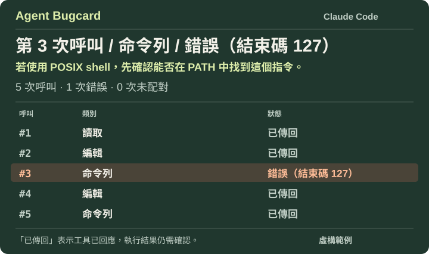

# Agent Bugcard · 工具錯誤診斷卡

[**開啟繁體中文示範**](https://vighzhen.github.io/agent-bugcard/?lang=zh-Hant) · [備用單檔下載](https://cdn.jsdelivr.net/gh/vighzhen/agent-bugcard@v0.3.0/docs/index.html) · [離線壓縮檔](https://vighzhen.github.io/agent-bugcard/agent-bugcard-offline.zip) · [简体中文](README.zh-CN.md) · [English](README.md)

遇到 Claude Code 或 Codex CLI 出錯時，可以把失敗的步驟整理給同事。工具會在你的電腦上讀取工作階段，依照你選擇的欄位產生診斷卡。原始對話、指令及檔案路徑都留在本機。



Claude 範例出現結束碼 **127**，可以先確認指令名稱與 PATH。切到 Codex 範例，結束碼 **126** 提示你先檢查檔案類型與執行權限。這是 POSIX shell 下的檢查方向，程式也可能自行傳回相同數值。

## 貼到群組聊天、工單或 Issue

1. 開啟示範，點 **Claude 範例** 或 **Codex 範例**。要回報自己的問題時，點 **開啟本機記錄檔**，選取一份 JSONL 檔案。每次開啟自己的檔案時，結束碼都會預設隱藏。
2. 選擇願意分享的呼叫、類別和結束碼。**卡片語言**可獨立於介面，例如使用中文操作，輸出英文報告給上游維護者。
3. **複製聊天純文字**適合貼到群組，**儲存圖片 PNG** 可產生圖片附件。要貼到 GitHub Issue 時，點 **複製 Markdown**，並加上一句預期的結果。

若瀏覽器不允許直接複製，頁面會選取文字；在電腦按 Ctrl+C 或 ⌘C，在手機長按複製。收到離線壓縮檔後先解壓縮，再用電腦瀏覽器開啟 `agent-bugcard.html`，離線也可使用範例、解析與匯出。

## 從備用位址取得離線檔案

建議優先使用上方的正式示範或站內離線壓縮檔。若你的網路無法開啟，可從備用 CDN 取得相同的 HTML。瀏覽器可能顯示原始碼；請以「另存新檔」儲存為 `agent-bugcard.html`（檔案類型選「所有檔案」），再以瀏覽器開啟。Windows 的 PowerShell 也可以執行：

```powershell
curl.exe -fL "https://cdn.jsdelivr.net/gh/vighzhen/agent-bugcard@v0.3.0/docs/index.html" -o agent-bugcard.html
```

## 到哪裡找工作階段檔案？

| 工具 | macOS / Linux | Windows 檔案總管網址列 |
| --- | --- | --- |
| Claude Code | `~/.claude/projects/` | `%USERPROFILE%\.claude\projects` |
| Codex CLI | `~/.codex/sessions/` | `%USERPROFILE%\.codex\sessions` |

從子資料夾選取一份檔案，最多 20 MiB。若已設定 `CLAUDE_CONFIG_DIR` 或 `CODEX_HOME`，請從自訂資料夾尋找。

## 命令列

在專案目錄使用 Node.js 18+ 執行：

```sh
node bin/agent-bugcard.cjs examples/claude.synthetic.jsonl --lang zh-Hant --exit-codes --format text
node bin/agent-bugcard.cjs examples/claude.synthetic.jsonl --lang zh-Hant --call 3 --exit-codes --format svg > receipt.svg
```

也可以透過管線將本機程式的輸出傳給 `--stdin`，不用建立中間 JSONL 檔案。此參數與檔名二選一，輸入仍在本機處理，上限同為 20 MiB。

**已傳回**表示有工具回應，執行結果仍需確認。**未配對**表示找不到對應的完成記錄。回報解析問題時，請附自行編寫的最小範例。[回報問題](https://github.com/vighzhen/agent-bugcard/issues)
